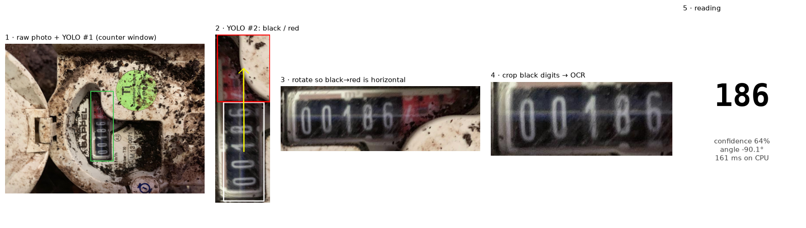
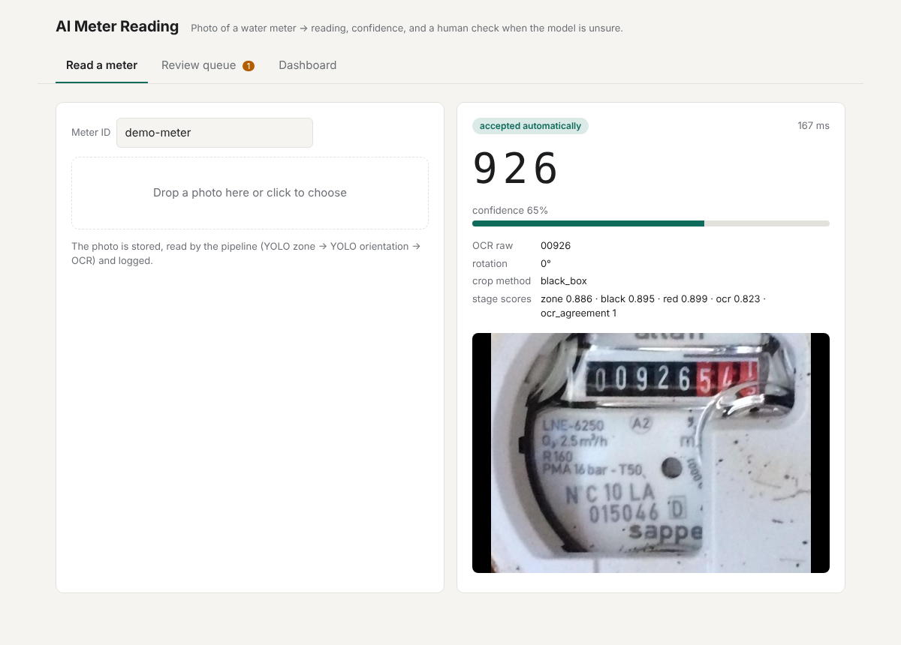
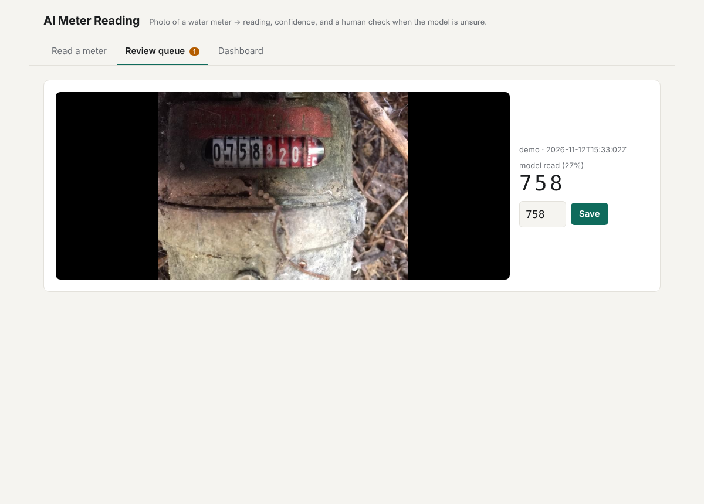
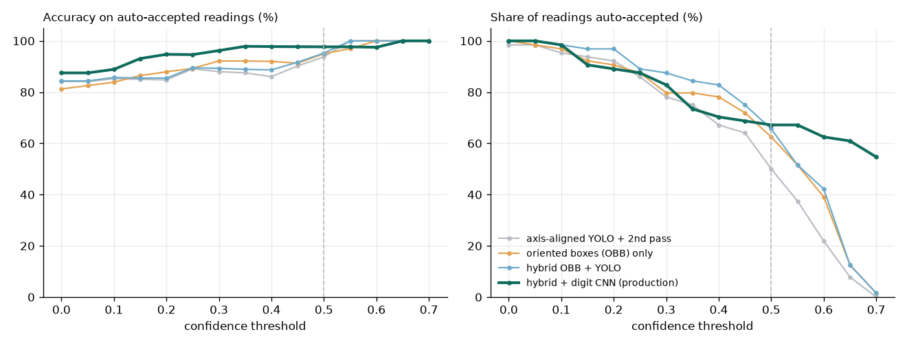
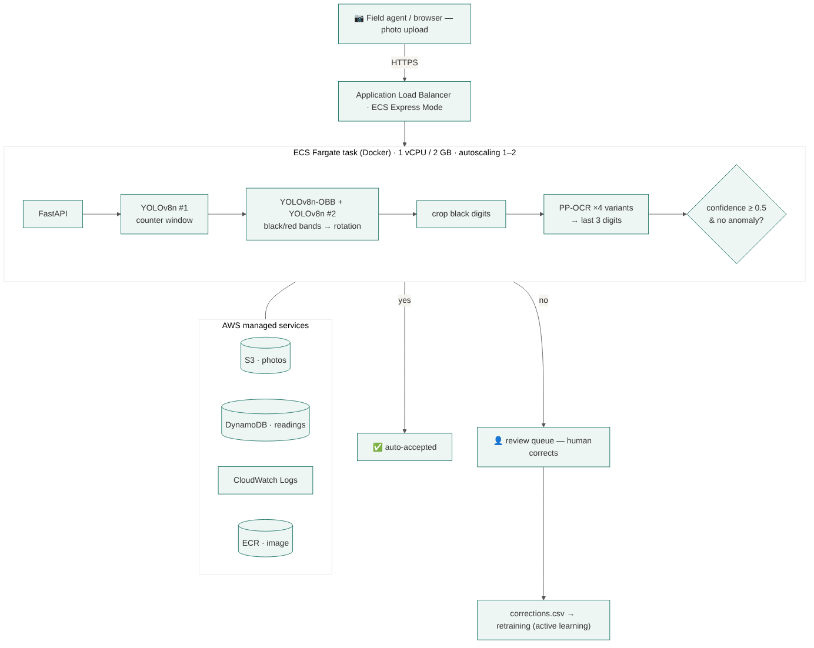

# AI Meter Reading

**A water-meter photo goes in. The reading, a confidence score and a human check when the model is unsure come out. Deployed on AWS.**

> Started as a one-week team project in school (original notebook: [QuiterieGuignard/AI-for-meters-reading-](https://github.com/QuiterieGuignard/AI-for-meters-reading-)). This repo is my rebuild of it as a deployed product: a clean pipeline, a held-out evaluation, an API with human review, and AWS infrastructure.

Agents still read water meters by hand and type in the numbers, which makes errors and costs time. This service reads the meter from a phone photo. It accepts the readings it is sure about and sends the others to a review queue. Each human correction is saved as a new training label.



| Read a meter | Review queue | Dashboard |
|---|---|---|
|  |  |  |

---

## How it works

| Stage | Model / method | Why |
|---|---|---|
| 1. Find the counter window | **YOLOv8n #1**, fine-tuned from COCO weights on a small set of photos hand-labelled in Roboflow, then retrained on its own confident predictions (**pseudo-labelling**, conf ≥ 0.3). Dataset: 795 meter photos. | Photos are taken from any distance and angle. Detection isolates the region of interest. |
| 2. Orientation | **YOLOv8n-OBB** (rotated boxes, trained on my annotations) + the original **YOLOv8n #2** detect the *black* (m³) and *red* (litres) digit blocks | The black-to-red vector gives the meter's orientation, so photos taken sideways or upside down are fixed with one rotation (`atan2`). |
| 3. Rotate + crop | Rotate on an enlarged canvas so no corner is lost. Crop the rotated black box. | Only the integer digits go to the OCR. The red litres are dropped. |
| 4. Read | **PP-OCR recogniser** (ONNX, via RapidOCR) on **4 test-time variants** of each crop, plus a **digit CNN** trained on our own meter bands | Two independent readers: when they agree the reading is almost always right; when they disagree a human checks. |
| 5. Decide | `confidence = P(zone) × P(black block) × OCR score × agreement`. Readings ≥ 0.5 are auto-accepted, the rest go to review. A consumption check per meter (robust z-score, modulo-1000 rollover) also sends suspicious jumps to review. | Wrong readings are costly, so the system stays precise and a human handles the uncertain ones. |

## Results

Tested on 70 labelled photos the OCR never saw. 6 of those labels contradict the photo ([`data/label_issues.csv`](data/label_issues.csv)) and are excluded below.



Progression on the same 64 test photos (labels verified):

| Version | Exact match | Auto-accepted at threshold 0.5 | Accuracy on auto-accepted | Median latency (CPU) |
|---|---|---|---|---|
| Colab version rebuilt as-is (EasyOCR, first 30 photos) | ≈13 % | – | – | – |
| Axis-aligned YOLO crop, PP-OCR | 67 % | 39 % | 96 % | 170 ms |
| + 2nd detection pass on the straightened image | 83 % | 50 % | 94 % | 240 ms |
| Oriented-box detector (YOLOv8n-OBB) only | 81 % | 62 % | 95 % | 190 ms |
| Hybrid: OBB + 2nd pass, keep the crop the OCR is most sure of | 84 % | 66 % | 95 % | 290 ms |
| **+ digit CNN as a second reader (production)** | **88 %** | **67 %** | **98 %** | 320 ms |

The OBB detector (`models/yolo/orientation_obb.pt`) is a YOLOv8n-OBB fine-tuned on 164 crops I annotated with rotated polygons (black band / red band), with flips disabled (a mirror would put red on the left) and ±180° rotation augmentation. Validation mAP50 = 0.995, mAP50-95 = 0.87. None of the 70 test photos were in its training set (`scripts/train_obb.py`, `scripts/compare_modes.py`).

The **digit CNN** (`models/digit_reader.pt`, 0.7 M parameters) reads the last 3 black digits directly from the straightened band. It was trained on 651 bands built from the team's crops with the project's labels (test photos excluded), using the same OBB + rotation code as production (`scripts/build_digit_dataset.py`, `scripts/train_digits.py`). It is used as a **second, independent reader**: when the CNN and the OCR agree (69 % of test photos) the reading is right 98 % of the time; when they disagree, the more confident one is kept and the confidence is cut so a human checks it.


Main failure modes: digits caught mid-turn (e.g. 7↔8), heavy blur, and very small or dirty counters. Caveat: the eval photos come from the same pool the YOLO models were trained on, so the detection stages may look better here than on new meters. The OCR stage was never trained on this data.

**What changed vs. the first (Colab) version**
- The orientation weights store their class names swapped (`{0:'rouge', 1:'noir'}`) while the labels were written with `noir=0`. Using the names silently turned images upside down. The fix uses the class ids, checked by eye.
- A fixed crop `img[83:173, 18:238]` plus red-pixel cutting was replaced by a crop on the detected black box after rotation.
- EasyOCR (≈13 % here) was replaced by the PP-OCR recogniser with test-time augmentation (≈60 %+). The ResNet18 / 3-head CNN tried before reached ~1 %.
- The axis-aligned orientation boxes were loose on tilted meters (they swallowed background and red digits). I annotated 164 crops with rotated polygons and trained an oriented-box (OBB) detector: tight crops at any angle, +16 points of automation.
- Validation was done on the training set. It now uses a separate labelled evaluation (`scripts/evaluate.py`).

## Architecture (AWS)



- **ECS Express Mode** (Fargate + Application Load Balancer + autoscaling 1–2 tasks, 1 vCPU / 2 GB). It runs the Docker image stored in **ECR**.
- **S3** stores the photos (private bucket, public access blocked). **DynamoDB** stores readings and human corrections (on-demand).
- **CloudWatch Logs** get one structured log line per reading and per review.
- **IAM**: the task role can only `PutObject`/`GetObject` on `photos/*` of its own bucket and `PutItem`/`GetItem`/`Scan` on its own table. No keys live in the code or the image.
- The same code runs locally with `STORAGE=local` (SQLite + disk), which keeps dev and tests free.

## API

| Method | Path | |
|---|---|---|
| `POST` | `/api/readings` | multipart `file` (+ `meter_id`) → reading, confidence, status, consumption, anomaly |
| `GET` | `/api/readings?status=review` | review queue |
| `POST` | `/api/readings/{id}/review` | `{"value": "186"}` → `confirmed` / `corrected` |
| `GET` | `/api/stats` | automation rate, accuracy on reviewed, alerts, latency |
| `GET` | `/api/export/corrections.csv` | human-verified labels for the next training run |
| `GET` | `/health` | load-balancer health check |

## Run locally

```bash
python -m venv .venv && source .venv/bin/activate
pip install torch torchvision --index-url https://download.pytorch.org/whl/cpu
pip install -r requirements-dev.txt
pytest -q                                              # 12 tests
uvicorn meter_reader.api:app --app-dir src --port 8080 # open http://localhost:8080
```
or `docker build -t meter-reading . && docker run -p 8080:8080 meter-reading`

Evaluate on your own labelled photos (`image_id,reading` CSV):
```bash
python scripts/evaluate.py path/to/photos data/labels.csv
```

## Deploy to AWS

Requires AWS CLI v2 (recent), Docker and `aws configure` run with your own credentials.
```bash
./infra/deploy.sh    # S3 + DynamoDB + IAM + ECR + build/push + ECS Express service
./infra/status.sh    # status + public URL (≈5 min to become healthy)
./infra/update.sh    # ship a new version
./infra/destroy.sh   # delete everything (stops all costs)
```
Cost when always on: about $50/month (Fargate 1 vCPU/2 GB ≈ $36 + ALB ≈ $16). S3, DynamoDB and logs cost cents at demo scale. Run `destroy.sh` when the demo is over.

## Repo map
```
src/meter_reader/pipeline.py   detection → rotation → crop → OCR → confidence
src/meter_reader/api.py        FastAPI service + review workflow
src/meter_reader/storage.py    local (SQLite) / AWS (S3 + DynamoDB) back-ends
src/meter_reader/anomaly.py    consumption check per meter
src/meter_reader/static/       single-page UI (no framework)
models/yolo/                   the two YOLOv8n weights (6 MB each)
scripts/evaluate.py            accuracy + automation-rate report
infra/                         AWS deploy / update / destroy scripts
tests/                         pipeline, API and anomaly tests
```

## Next steps
1. **Close the loop.** Retrain the digit CNN on the exported human corrections (mid-turn digits are the main remaining error). Re-run `compare_modes.py` and ship only if accuracy at the same automation rate goes up.
2. Batch mode: an S3 upload event triggers an SQS queue and a worker, for the thousands of photos a utility receives each day.
3. Authentication (Cognito) and per-agent audit trail. Meter-ID / GPS from the photo's EXIF.
4. Drift monitoring: a CloudWatch metric on the automation rate, with an alarm when it drops.
